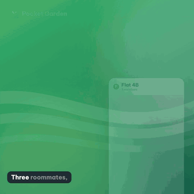
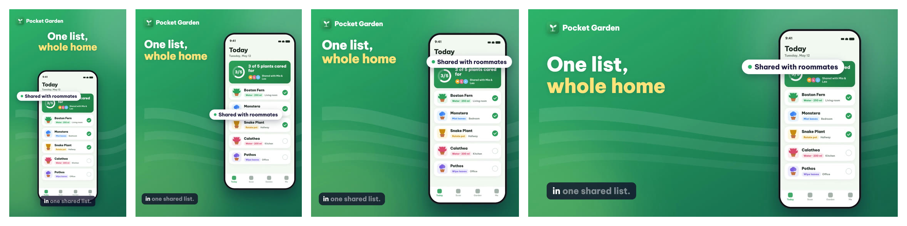
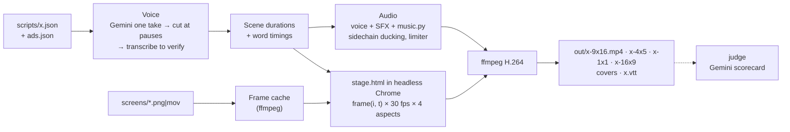

<div align="center">

# app-promo-video

**Screenshots + a JSON script → polished, voiced, captioned promo videos in every ad format.**
Built for AI agents: they write a 60-line JSON file, the engine does the rest.



<sub>Rendered from <a href="examples/starter/scripts/launch-en.json">one script</a> and <a href="examples/starter/screens">five mock screenshots</a>.
GIFs are silent: <a href="media/demo-1x1.mp4">watch the MP4 with voice and music</a>.</sub>

</div>

---

## What it makes

A 20–30 second ad for an app or product, the kind you see on TikTok, Reels, Shorts and in Google
or Meta campaigns:

- a **hook** in the first two seconds (a group chat in chaos, or a bold statement);
- your **real screens** in a floating phone (or a card for product photos), one benefit per scene, with pop-in headlines, benefit chips and zooms;
- **feature tiles** and an **end card** with a pulsing call to action, store badges and confetti;
- an **AI voice-over** steered by a director profile, **word-timed captions**, **original music** and **sound effects**, mixed with automatic ducking;
- **four aspect ratios from one script**: 9:16, 4:5, 1:1 and 16:9, plus a cover image and a `.vtt` caption file.



Everything is code, so a second language is a translated copy of the JSON, and a tenth video
costs the same as the first.

## Quick start (no API key needed)

```bash
git clone https://github.com/vochikhanh/app-promo-video && cd app-promo-video
npm install          # just puppeteer-core; uses the Chrome you already have
npm run doctor       # checks Node 18+, ffmpeg, Python 3, Chrome
npm run demo         # renders the example with captions + music, no voice
open examples/starter/out/launch-en-9x16.mp4    # (Linux: xdg-open, Windows: start)
```

**With a voice-over:** get a free [Gemini API key](https://aistudio.google.com/apikey), then

```bash
cp .env.example .env               # paste GEMINI_API_KEY=…
npm run build -- examples/starter/scripts/launch-en.json
```

**Your own video:**

```bash
npm link                             # once: makes `promo-video` available everywhere
promo-video new my-video             # copies the starter project
# put 3–6 screenshots in my-video/screens/, edit ads.json and scripts/launch-en.json
promo-video stills my-video/scripts/launch-en.json    # 2-second layout preview, no API calls
promo-video build  my-video/scripts/launch-en.json    # out/launch-en-{9x16,1x1,16x9,4x5}.mp4
promo-video judge  my-video/out/launch-en-9x16.mp4    # Gemini watches it and scores it
```

**Using an AI coding agent (Codex, Gemini CLI, Cursor…)?** Point your agent at this repo and ask:
*"Make a 25-second promo video for my app from these screenshots."* It will find
[`SKILL.md`](SKILL.md) / [`AGENTS.md`](AGENTS.md) and follow the [agent playbook](docs/agent-playbook.md).

## A script

```json
{
  "lang": "en",
  "theme": "garden",
  "music": "bright",
  "scenes": [
    { "type": "chat", "say": "Three roommates, twelve plants, and nobody remembers who watered what.",
      "big": "Three roommates,\n*one thirsty* fern", "shakeAt": 2.4,
      "chat": { "title": "Flat 4B", "msgs": [{ "who": "Mia", "text": "Did anyone water the fern?" }, { "me": true, "text": "Okay. We need a system." }] } },
    { "type": "phone", "clip": "today", "say": "Pocket Garden shows the whole home what needs care today, in one shared list.",
      "big": "One list,\n*whole home*", "chips": [{ "text": "Shared with roommates" }] },
    { "type": "phone", "clip": "scan", "say": "Not sure what a plant needs? Snap a photo and get a care plan in seconds.",
      "big": "Snap it,\n*know it*", "zoom": { "s": 1.35, "x": 0.5, "y": 0.76 } },
    { "type": "trio", "say": "Water plans, plant ID and daily tips, all in one app.", "big": "Everything,\n*one app*" },
    { "type": "end", "say": "Get Pocket Garden today and give your plants some love!", "cta": "Get Pocket Garden", "confetti": 0.5, "hold": 1 }
  ]
}
```

No timings anywhere: each scene lasts as long as its line takes to say. Editors autocomplete every
field from the [JSON Schema](schema/script.schema.json).

## Features

| | |
|---|---|
| 🖼️ **Stills are enough** | PNG/JPG/WebP screenshots or product photos. Motion comes from the device, zoom and type. Screen recordings (`.mov/.mp4`) are optional and mix freely. |
| 🗣️ **Voice that sounds directed** | Gemini TTS reads the whole script in **one take** with a director profile, the engine cuts it at the pauses, and Gemini transcribes every cut to verify it. Bad takes are re-read automatically. |
| 🔌 **Any TTS, or none** | `--no-voice` for captions + music only. Plug in macOS `say`, Piper, OpenAI, ElevenLabs or anything else with one line of config or a 20-line module. |
| 💬 **Word-timed captions** | Phrases of ~4 words, broken at punctuation, the spoken word lights up. Also exported as WebVTT. |
| 🎵 **Royalty-free by construction** | Music synthesized with the Python standard library (3 styles), SFX generated with ffmpeg, voice ducking with a sidechain compressor. No samples, no licenses. |
| 📐 **One stage, four formats** | 9:16, 4:5, 1:1, 16:9 from the same HTML stage. Layout per format is plain CSS. |
| 🌍 **Multi-language** | Per-language accent, pronunciation lexicon, caption phrasing, feature names and screenshots (`screens/vi-today.png`). Bundled font covers Latin + Vietnamese; add any OFL font for other scripts. |
| 🔍 **Review without watching** | `stills` → one contact sheet per format in 2 s. `judge` → a 7-line scorecard from Gemini. `sheet` → a 6-frame strip of any video. |
| 💸 **Cheap to iterate** | Voice, frames, music and SFX are cached by content. Changing colors or screenshots never re-runs TTS. An agent spends ~5–10k tokens per video. |
| 🧱 **Deterministic** | Every frame is a pure function of (scene, time). Same input, same video. |

## How it works



1. **Voice first.** Lines (after the pronunciation lexicon) are spoken, trimmed, normalized to −16 LUFS and cached. Their lengths define the timeline.
2. **Frames.** Each screenshot or recording becomes cached JPEG frames.
3. **Stage.** [`engine/stage.html`](engine/stage.html) is a normal web page. `setup(data)` builds every scene, `frame(i, t)` poses it for second `t`. Puppeteer screenshots 30 frames per second straight into ffmpeg.
4. **Audio.** Voice lines are padded to their scenes; whoosh/pop/ding events and synthesized music are mixed, with the music ducking under the voice.
5. **Outputs** per aspect, a cover image, and captions as `.vtt`.

## Aspect ratios

| Flag | Size | Use it for |
|---|---|---|
| `9x16` | 1080×1920 | TikTok, Reels, Shorts, Stories, store previews |
| `4x5` | 1080×1350 | Facebook and Instagram feed |
| `1x1` | 1080×1080 | Feeds, Google Ads |
| `16x9` | 1920×1080 | YouTube, Google Ads, landing pages |

`--aspects 9x16,4x5` renders a subset; `--aspects all` renders all four.

## Commands

| Command | What it does |
|---|---|
| `promo-video new <dir>` | Start a project from the starter template |
| `promo-video check <script>` | Validate a script with precise, friendly errors |
| `promo-video stills <script>` | One frame per scene per aspect + a contact sheet per aspect |
| `promo-video build <script>` | Render. `--aspects`, `--no-voice`, `--no-music`, `--no-captions`, `--crf`, `--chrome`, `--project`, `--quiet` |
| `promo-video judge <file> ["question"]` | Gemini reviews a video (scorecard), an image (layout problems) or audio |
| `promo-video voices "<line>"` | Read a line in several Gemini voices and rank them |
| `promo-video sheet <video>` | 6 evenly spaced frames in one strip |
| `promo-video doctor` | Check the toolchain |

Inside the repo, every command is also an npm script: `npm run build -- <script> --aspects 9x16`.

## Requirements

- **Node 18+** and `npm install` (one dependency: `puppeteer-core`)
- **Chrome, Chromium or Edge** (auto-detected on macOS, Linux and Windows; or set `CHROME_PATH`)
- **ffmpeg + ffprobe**
- **Python 3** (standard library only, for the music)
- *Optional:* `GEMINI_API_KEY` for the voice-over and `judge`

## Documentation

| | |
|---|---|
| [Script format](docs/script-format.md) | Every field of a script and of `ads.json`, outputs |
| [Scene types](docs/scene-types.md) | `chat`, `text`, `phone`, `trio`, `end`, and adding your own |
| [Design tips](docs/design-tips.md) | Hooks, headlines, captions, color, sample data, per-platform notes |
| [Voice](docs/voice.md) | Director profiles, choosing a voice, lexicon, plugging in other TTS |
| [Music and sound](docs/music-and-sound.md) | The synth, SFX recipes, the ducking mix |
| [Agent playbook](docs/agent-playbook.md) | How an AI agent should drive this with as few tokens as possible |
| [Recording](docs/recording.md) | Optional screen recordings from iOS / Android / desktop |
| [Troubleshooting](docs/troubleshooting.md) | Setup, voice, picture and output problems |

## FAQ

**Do I need to record my screen?** No. Screenshots are the default and usually look better. Record
only when the motion itself sells the product.

**Does it work without an API key?** Yes: `--no-voice` (or `"provider": "none"`) renders captions,
music and SFX, timed by reading speed. Or use a free local TTS such as macOS `say` or Piper.

**How much does a video cost?** Rendering is local. With Gemini: one TTS request for the whole
script plus a few short transcription calls to verify the cuts, and one optional `judge` call.

**Which languages?** Any language your TTS speaks. The bundled Be Vietnam Pro font covers Latin
and Vietnamese; add an OFL font (e.g. Noto Sans JP) in `ads.json › fonts` for other scripts.

**Can I change the look?** Yes. It is HTML and CSS: [`engine/stage.html`](engine/stage.html).
Colors come from themes in `ads.json`; each aspect ratio has its own small CSS block.

**Product photos instead of an app?** Use `"device": "card"` for a frameless 4:5 card, and
`"badges": []` to drop the store pills.

**Is the output allowed in ads?** The code, music and SFX are yours to use. Check your TTS
provider's terms for the voice, and each ad platform's policies (claims, prices, store-preview rules).

**Why is rendering CPU-bound and not instant?** Each frame is a real browser screenshot, which is what
makes it pixel-exact and deterministic. Expect about a minute per aspect for a 25-second video.

## Author & origin

Created by **Võ Chí Khanh** ([@vochikhanh](https://github.com/vochikhanh)), founder of
[**CTAS**](https://ctas.vn), an ecosystem of apps for Vietnamese businesses and families
(workforce & payroll, training, e-commerce, everyday-life tools).

This engine was extracted and generalized from the pipeline that produces the app-store and social
ads for CTAS products: the first run made 48 launch videos (6 angles × 2 languages × 4 aspect ratios),
written and iterated by an AI agent. The example project here is a fictional app with mock screens
drawn in code; no CTAS data or credentials are included.

## Contributing

Issues and pull requests are welcome: new scene types, music styles, voice providers, layouts.
See [CONTRIBUTING.md](CONTRIBUTING.md).

## License

Code, docs and example assets: [MIT](LICENSE). The bundled Be Vietnam Pro font is under the
[SIL Open Font License 1.1](fonts/OFL.txt).
